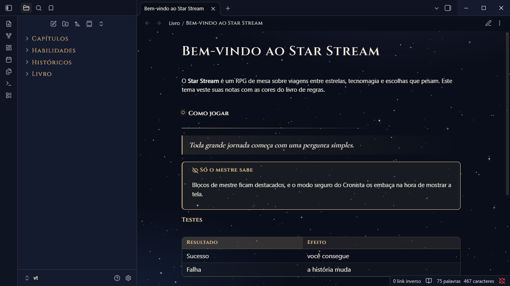

# Star Stream

Os temas do livro de regras do **Star Stream**, agora para o Obsidian.

## O que vem no tema

- **10 temas** em duas famílias:
  - **Astra:** Clássico, Constelação, Nebulosa, Observatório, Astrolábio e Códex;
  - **Sci-fi:** Radar, Holograma, Circuito e Navegação.
- **6 paletas de cor** em cada tema, num total de 60 combinações.
- **Claro e escuro**, que seguem o modo do próprio Obsidian.
- **Fontes e desenhos embutidos**, para funcionar sem internet.

## Como escolher tema e paleta

1. Instale o plugin **Style Settings**, que fica nos plugins da comunidade.
2. Abra Configurações → Style Settings → Star Stream.
3. Escolha na lista "Tema · Paleta". O padrão é Constelação · Ouro.

## Blocos especiais

| Bloco | Para quê |
| --- | --- |
| `> [!mestre]` | O que só o mestre sabe. |
| `> [!segredo]` | O segredo profundo. |
| `> [!pergunta]` | Uma ponta solta para decidir depois. |
| `> [!sugestao]` | Uma ideia que ainda não é canon. |

Com o plugin Cronista, o modo seguro (Ctrl+Shift+S) embaça os blocos de mestre e de segredo quando você precisa mostrar a tela aos jogadores.
